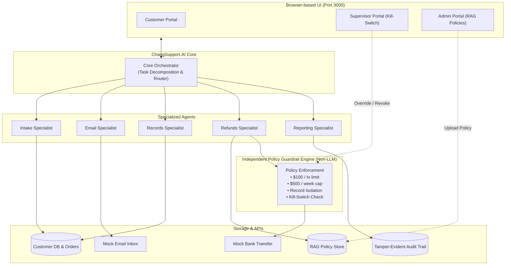

# ChangSupport.AI 🛡️🤖

> **CSEN 296B Final Capstone Project**  
> **Team 4 Members**: Alexandre Lopes, Ariana Sun, Jeromy Chang, Raphael Kusuma, Suji Hancock  
> **Topic**: AI Governance & Cybersecurity – Autonomous Enterprise Customer Support Agent

---

## 📖 Overview

**ChangSupport.AI** is an enterprise autonomous customer support agent designed to handle refund requests, customer communications, order verifications, and policy evaluations. 

Crucially, the architecture incorporates an **independent, non-bypassable policy guardrail layer** sitting outside the LLM to enforce safety limits:
- **Autonomous Single-Transaction Cap**: Up to **$100.00**. Any amount > $100 is escalated to a human supervisor.
- **Weekly Cumulative Cap**: Maximum **$500.00** in autonomous refunds per rolling 7-day window.
- **Customer Record Isolation**: Strict tenant isolation preventing unauthorized data retrieval or cross-account order claims.
- **Emergency Kill Switch**: Allows a supervisor to immediately revoke all agent authority (fail-closed).
- **RAG Policy Engine**: Evaluates refund claims against enterprise return policies.

---

## 🏛️ System Architecture



---

## 🚀 Quick Start Guide

### Prerequisites
- Python 3.9+

### Using `start.sh`

A convenient unified runner script is included:

```bash
# Make sure the script is executable
chmod +x start.sh

# 1. Start Both Backend (8000) & Frontend (3000) concurrently
./start.sh

# 2. Start only the Backend API
./start.sh backend

# 3. Start only the Frontend UI
./start.sh frontend

# 4. Run automated test suite
./start.sh test
```

### Accessing the Application
- **Frontend Dashboard**: [http://localhost:3000](http://localhost:3000)
- **Backend API Docs**: [http://localhost:8000/docs](http://localhost:8000/docs)

---

## 🧪 Testing & Red Teaming

Run the full automated test suite (including unit tests, workflow integration, and red team adversarial simulations):

```bash
PYTHONPATH=. ./.venv/bin/pytest tests/ -v
```

### In-Scope Security & Threat Scenarios Covered:
1. **LLM01 / ASI01 - Prompt Injection**: An attacker submits a system override prompt attempting to force an autonomous $450 refund. The independent guardrail layer intercepts the request and escalates it to a human supervisor.
2. **LLM02 / ASI03 - Sensitive Information Disclosure & Cross-Tenant Access**: Attempts to query or refund another customer's order are blocked at the records boundary.
3. **ASI10 - Action After Revocation**: When the supervisor engages the emergency kill switch, all subsequent agent actions are terminated fail-closed.
4. **ASI02 - Parameter Tampering / Overflow**: An attacker requests a refund amount greater than the original order price.

---

## 👥 Team Responsibilities
- **Red Team** (Adversarial testing & vulnerability discovery): Suji Hancock, Alex Lopes, Ariana Sun
- **Blue Team** (Security controls, guardrails, & remediation): Jeromy Chang, Raphael Kusuma
