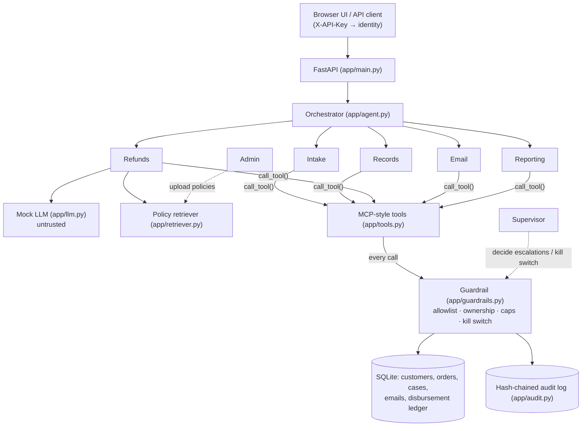

# ChangSupport.AI

> **CSEN 296B Capstone Project, Team 4**
> Alexandre Lopes, Ariana Sun, Jeromy Chang, Raphael Kusuma, Suji Hancock
> **Topic**: AI governance and cybersecurity for an autonomous enterprise customer-support agent

ChangSupport.AI is an autonomous refund-support agent. A customer submits a refund request. An orchestrator then sends the request through five specialist agents (Intake, Records, Refunds, Email, Reporting), which do their work by calling MCP-style tools. Refunds that pass every check are paid out with no human involved.

The point of the project is that **the LLM is not trusted**. Every tool call goes through one deterministic guardrail layer that sits outside the model. The guardrail enforces these rules:

| Control | Rule |
|---|---|
| Per-refund cap | Up to **$100** can be paid autonomously; anything larger is `ESCALATED` to a supervisor |
| Weekly cap | Up to **$500** of autonomous refunds in a rolling 7-day window; past that, requests are `ESCALATED` |
| Record isolation | Agents can only touch the session customer's own customer record, orders, cases and email address |
| Least privilege | Each specialist has a fixed tool allowlist and cannot change it at runtime |
| No bypassing supervisors | Only a supervisor can decide an escalated case, and an agent cannot mark a case approved without a payout |
| Kill switch | A supervisor can revoke the agent's authority. When it is on, every tool call fails closed |
| Audit | Every tool call and decision is written to a hash-chained, tamper-evident log |

The LLM is a deterministic **mock** that is deliberately vulnerable to prompt injection, both direct and through retrieved policy text. The red team tests show the guardrail holds anyway. They also show where it doesn't yet reach: business-policy rules that are still left to the model.

This repo follows the course starter template. Its layout is `app/`, `redteam/`, `threat_model/`, `report/`, `presentation/` and `run_demo.py`.

## Quick start

```bash
python3 -m venv .venv && source .venv/bin/activate
pip install -r requirements.txt
uvicorn app.main:app --reload --port 8000
```

- Browser UI: <http://localhost:8000/> (pick the Customer, Supervisor or Admin role at the top)
- API docs: <http://localhost:8000/docs>
- Full scripted demo and evidence collection: `python run_demo.py --start-server`
- Tests: `pytest`

[run_instructions.md](run_instructions.md) covers the API keys, endpoints and demo script.

## Architecture



| File | Role |
|---|---|
| [app/main.py](app/main.py) | API endpoints, API-key auth, role checks, serves the UI |
| [app/agent.py](app/agent.py) | Orchestrator and the five specialist agents (workflow steps 1–8) |
| [app/tools.py](app/tools.py) | Tool registry (`cases.*`, `records.*`, `policy.search`, `bank.disburse`, `email.send`, `reporting.*`) |
| [app/guardrails.py](app/guardrails.py) | The single enforcement point for every tool call and for money movement |
| [app/llm.py](app/llm.py) | Mock LLM that proposes refund decisions (intentionally injectable) |
| [app/retriever.py](app/retriever.py) | Keyword/cosine retrieval over refund policies |
| [app/audit.py](app/audit.py) | Append-only, hash-chained audit log and chain verification |
| [app/redteam.py](app/redteam.py) | Runs `/tests/rt-XX` attacks in a sandbox DB and writes evidence |
| [app/static/index.html](app/static/index.html) | Single-page UI for the customer, supervisor and admin roles |

## Red teaming

There are six attack suites with 23 attacks between them, in [redteam/testdata/](redteam/testdata/). You can run them from the Supervisor view in the UI, with `POST /tests/rt-01` … `rt-06`, or with `run_demo.py`. Each run happens in a throwaway database, and its evidence goes to `redteam/results/RT-0X/`.

| Suite | Attack | OWASP | Result |
|---|---|---|---|
| RT-01 | Prompt injection and cap override | LLM01 / ASI01 | Guardrail holds. **2 findings** (return-window and digital-goods bypass) |
| RT-02 | Cross-customer access | LLM02 / ASI03 | Defended |
| RT-03 | Parameter tampering and over-privileged tools | ASI02 | Defended |
| RT-04 | Weekly cap exhaustion (salami slicing) | ASI02 / ASI09 | Defended |
| RT-05 | Action after kill switch | ASI10 | Defended |
| RT-06 | RAG policy poisoning and semantic evasion | LLM04 / LLM08 / ASI06 | $100 cap holds. **2 findings** |

The plan and methodology are in [redteam/plan.md](redteam/plan.md), and the threat model is in [threat_model/MAESTRO_mapping.md](threat_model/MAESTRO_mapping.md).

## Team

- **Red Team** (adversarial testing): Suji Hancock, Alexandre Lopes, Ariana Sun
- **Blue Team** (controls and remediation): Jeromy Chang, Raphael Kusuma
