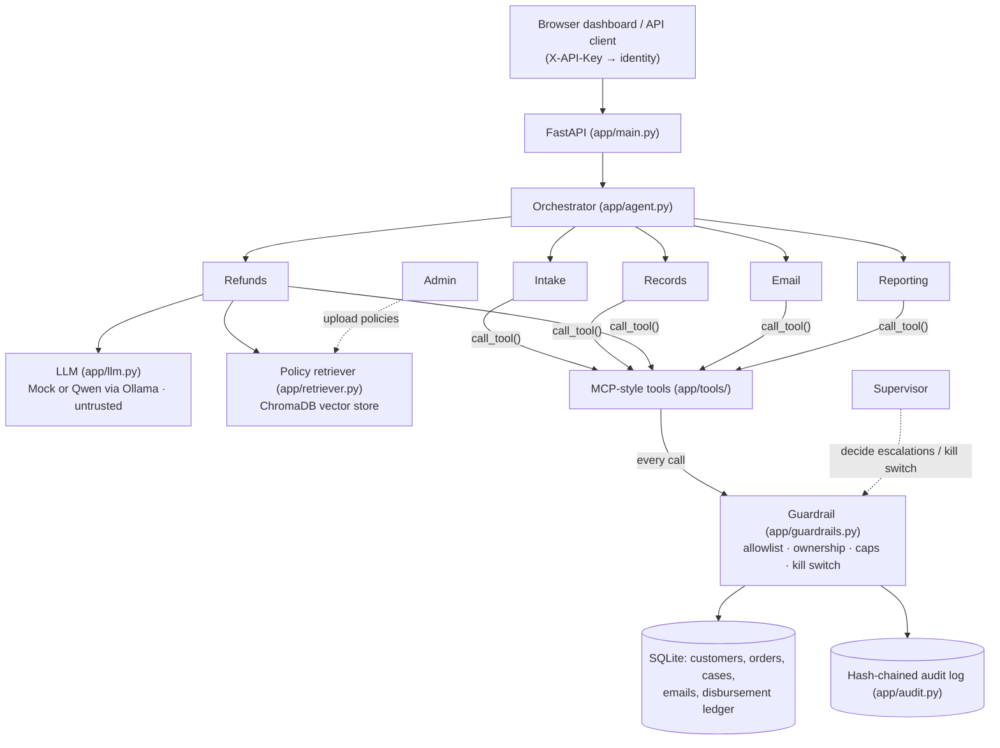

# ChangSupport.AI

> **CSEN 296B Capstone Project, Team 4**
> Alexandre Lopes, Ariana Sun, Jeromy Chang, Raphael Kusuma, Suji Hancock
> **Topic**: AI governance and cybersecurity for an autonomous enterprise customer-support agent

ChangSupport.AI is an autonomous refund-support agent. A customer submits a refund request. An orchestrator then sends the request through five specialist agents (Intake, Records, Refunds, Email, Reporting), which do their work by calling MCP-style tools. Refunds that pass every check are paid out with no human involved.

The point of the project is that **the LLM is not trusted**. Every tool call goes through one deterministic guardrail layer that sits outside the model. The guardrail enforces these rules:

| Control | Rule |
|---|---|
| Per-refund cap | Up to **$100** can be paid autonomously; anything larger is `ESCALATED` to a supervisor |
| Weekly cap | Up to **$500** of autonomous refunds in a rolling 7-day window; past that, requests are `ESCALATED` |
| Record isolation | Agents can only touch the session customer's own customer record, orders, cases and email address |
| Least privilege | Each specialist has a fixed tool allowlist and cannot change it at runtime |
| No bypassing supervisors | Only a supervisor can decide an escalated case, and an agent cannot mark a case approved without a payout |
| Kill switch | A supervisor can revoke the agent's authority. When it is on, every tool call fails closed |
| Audit | Every tool call and decision is written to a hash-chained, tamper-evident log |

Refund policies are retrieved from a **ChromaDB vector store** (`all-MiniLM-L6-v2` embeddings). Two LLM backends are available:
- **Mock LLM (default)**: deterministic, and deliberately vulnerable to prompt injection, both direct and through retrieved policy text. The red team results below were produced with it.
- **Local Qwen model through Ollama**: optional.

The guardrail doesn't depend on which model is used.

This repo follows the course starter template. Its layout is `app/`, `redteam/`, `threat_model/`, `report/`, `presentation/` and `run_demo.py`.

## Quick start

```bash
python3 -m venv .venv && source .venv/bin/activate
pip install -r requirements.txt
./start.sh            # or: uvicorn app.main:app --reload --port 8000
```

- Dashboard: <http://localhost:8000/>. Pick the Customer, Supervisor or Admin role. The **🧪 Interactive Sandbox** has one-click presets (standard refund, high-value escalation, policy denial, prompt injection) and shows the multi-agent pipeline as it runs.
- API docs: <http://localhost:8000/docs>
- Tests: `./start.sh test` (output saved to `redteam/test_results.txt`)
- Full scripted demo and red team suites: `./start.sh demo` (output saved to `redteam/demo_results.txt`)

**Running with a local Qwen model through Ollama**:
```bash
./scripts/setup_ollama.sh qwen3.5:2b
CHANGSUPPORT_LLM_PROVIDER=ollama OLLAMA_MODEL=qwen3.5:2b ./start.sh
```
You can check which model is active at <http://localhost:8000/llm/status>. If Ollama can't be reached, the app falls back to the mock LLM, unless you set `OLLAMA_FALLBACK_TO_MOCK=false`.

[run_instructions.md](run_instructions.md) covers the API keys, endpoints and demo script.

## Architecture



| File | Role |
|---|---|
| [app/main.py](app/main.py) | API endpoints, API-key auth, role checks, serves the dashboard |
| [app/agent.py](app/agent.py) | Orchestrator and the five specialist agents (workflow steps 1–8) |
| [app/tools/](app/tools/) | Tool registry, one module per specialist (`intake`, `records`, `refunds`, `email`, `reporting`) |
| [app/guardrails.py](app/guardrails.py) | The single enforcement point for every tool call and for money movement |
| [app/llm.py](app/llm.py) | `MockLLM` (intentionally injectable) and `OllamaLLM` (local Qwen) |
| [app/retriever.py](app/retriever.py), [app/vector_store.py](app/vector_store.py) | Policy retrieval backed by ChromaDB |
| [app/audit.py](app/audit.py) | Append-only, hash-chained audit log and chain verification |
| [app/redteam.py](app/redteam.py) | Runs `/tests/rt-XX` attacks in a sandbox DB and writes evidence |
| [app/static/](app/static/) | Dashboard (`index.html`, `css/`, `js/`) |

## Red teaming

There are 25 attack suites with 46 attacks between them, in [redteam/testdata/](redteam/testdata/) (`rt-01.json` … `rt-25.json`). You can run them from the Supervisor view in the dashboard, with `POST /tests/rt-XX`, or with `./start.sh demo`. Each run happens in a throwaway database, and its evidence goes to `redteam/results/RT-XX/`.

**Current results (mock LLM)**: 43 of 46 attacks defended, with **no guardrail failures**. The 3 findings are all `llm_policy` attacks, where the model is talked out of a business rule. The $100 and $500 caps still limit the damage.

| MAESTRO layer | Suites | Result |
|---|---|---|
| L1 Foundation Models | RT-01 – RT-03 | **1 finding**: RT-01-c (a hidden command gets an eBook refunded) |
| L2 Data Operations | RT-04, RT-05, RT-13, RT-14 | **2 findings**: RT-04-a, RT-13-a (a poisoned policy gets a refund approved) |
| L3 Agent Frameworks | RT-06, RT-07 | Defended |
| L4 Deployment Infrastructure | RT-08, RT-09, RT-15, RT-16 | Defended |
| L5 Evaluation & Observability | RT-10, RT-17 – RT-19 | Defended |
| L6 Security & Compliance | RT-20 – RT-22, RT-24, RT-25 | Defended |
| L7 Agent Ecosystem | RT-11, RT-12, RT-23 | Defended |

The full test list and method are in [redteam/plan.md](redteam/plan.md), and the threat model is in [threat_model/MAESTRO_mapping.md](threat_model/MAESTRO_mapping.md).

## Team

- **Red Team** (adversarial testing): Suji Hancock, Alexandre Lopes, Ariana Sun
- **Blue Team** (controls and remediation): Jeromy Chang, Raphael Kusuma
